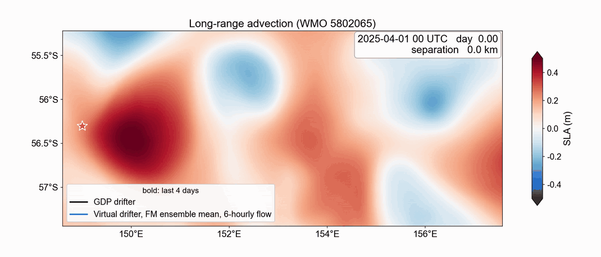
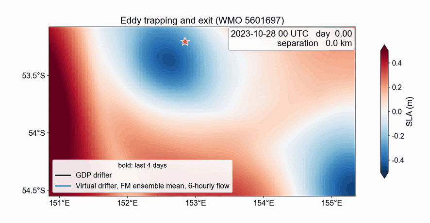

# Toward Daily SWOT-Scale Sea Surface Height Maps: Insights From a Simulation-Trained Generative Model

Official implementation for:

>Toward Daily SWOT-Scale Sea Surface Height Maps: Insights From a Simulation-Trained Generative Model.

## Overview

This repository implements a Conditional Flow Matching (CFM) generative framework for reconstructing daily fine-scale sea surface height (SSH) ensembles from operational nadir-altimeter maps (DUACS) and sparse SWOT Level-3 KaRIn wide-swath observations.

## Repository Structure

```text
├── assets/                          # Drifter trajectory GIFs
├── configs/
│   ├── config.yaml                  # Model, simulator, baseline, and training configuration
│   ├── normalization.json           # Training normalization statistics
│   └── simulator_calibration.json   # Calibrated DUACS simulator parameters (L=150 km, T=4 d)
├── data/
│   ├── llc4320_osse_sample.h5       # Sample LLC4320 OSSE dataset
│   ├── duacs_swot_sample.h5         # Sample DUACS + SWOT Level-3 dataset
│   ├── cnes_cls22_mdt.npz           # Mean dynamic topography (CNES-CLS22)
│   ├── SSH_ACC_20230422.nc          # Sample daily CFM-reconstructed NetCDF product
│   ├── duacs_l4_sample.nc           # Sample operational DUACS Level-4 NetCDF
│   └── gdp_drifters_sample.csv      # Sample 6-hourly GDP drifter records
├── scripts/
│   ├── train.py                     # Train CFM or baseline models (unet, fno, vit, fourdvarnet, edm, ddpm)
│   ├── reconstruct.py               # Reconstruct daily SWOT-scale SSH NetCDF maps
│   └── evaluate.py                  # Evaluate OSSE and withheld-SWOT spectral metrics
├── src/swot_cfm/
│   ├── model.py                     # Four-scale Attention U-Net velocity network
│   ├── baselines.py                 # U-Net, FNO, ViT, 4DVarNet, EDM, and DDPM baseline implementations
│   ├── flow_matching.py             # CFM training objective and Heun ODE ensemble sampler
│   ├── dataset.py                   # 20-channel observation-conditioning datasets
│   ├── observations.py              # SWOT swath detrending and multi-bin innovation encoding
│   ├── preprocessing.py             # Tidal removal and 25-hr balanced SSH extraction
│   ├── simulator.py                 # Virtual nadir-altimeter constellation and OI simulator
│   ├── spectra.py                   # Along-track PSD, spectral skill, and effective resolution
│   ├── diagnostics.py               # Geostrophic currents, vorticity, KE flux, and RK4 advection
│   └── utils.py                     # Configuration loader and physical constants
└── weights/
    └── best.pt                      # Pretrained CFM model checkpoint
```

## Data Availability

### Input and Validation Data

Full raw datasets are obtained from their official repositories:

- **MITgcm LLC4320 Hourly Simulation**: Southern Ocean Pre-SWOT LLC4320 archive, NASA PO.DAAC (https://doi.org/10.5067/PRESW-ASJ10)
- **Operational DUACS Level-4 SSH**: $0.125^\circ$ daily product (`SEALEVEL_GLO_PHY_L4_MY_008_047`), Copernicus Marine Service (https://doi.org/10.48670/moi-00148)
- **SWOT Level-3 KaRIn SSH**: Low-Rate SSH Expert v3.0, AVISO+/CNES (https://doi.org/10.24400/527896/A01-2023.018)
- **Experimental SWOT-Enhanced MIOST Level-4 SSH**: CNES/CLS via AVISO+ (https://doi.org/10.24400/527896/A01-2025.001)
- **Global Drifter Program (GDP)**: Quality-controlled 6-hourly interpolated records, NOAA/NCEI (https://doi.org/10.25921/7ntx-z961)

### Our Reconstructed Dataset

The daily CFM-reconstructed SSH product (29 March 2023 to 31 December 2025) are available on Zenodo (https://doi.org/10.5281/zenodo.24248872).

## Drifter Trajectory

The two cases compare Global Drifter Program (GDP) observations (black) with virtual drifters advected by the CFM ensemble-mean geostrophic currents (blue).

### Long-range advection (WMO 5802065)



### Eddy trapping and exit (WMO 5601697)



## Usage
Download the complete package (including pretrained weights) from Releases and extract it.
```bash
pip install -r requirements.txt
pip install -e .

# 1. Reconstruct daily NetCDF SSH ensemble maps
python scripts/reconstruct.py --days 2023-04-22 --out-dir outputs/reconstructions --overwrite

# 2. Evaluate OSSE and withheld-SWOT spectral metrics
python scripts/evaluate.py --steps 32 --members 16

# 3. Train CFM (default) or a baseline model (unet | fno | vit | fourdvarnet | edm | ddpm)
python scripts/train.py --config configs/config.yaml
python scripts/train.py --model <baseline> --config configs/config.yaml  # e.g., vit, fno, fourdvarnet, edm
```
